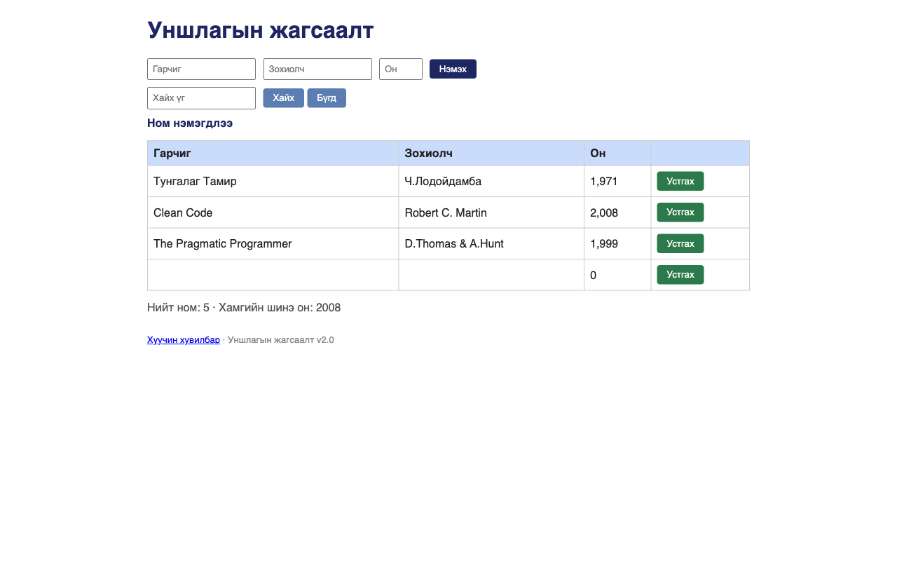
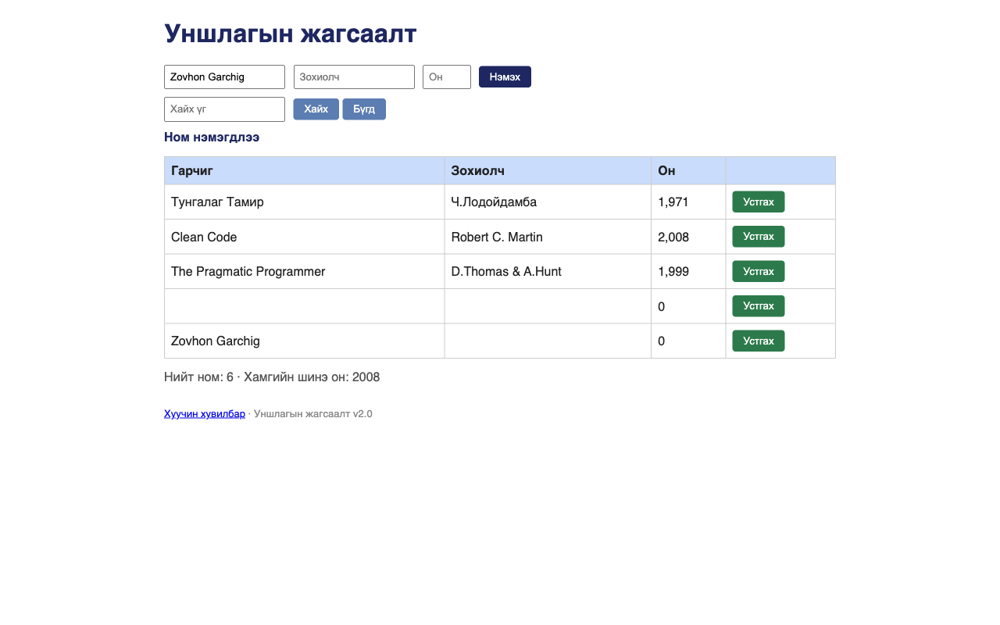
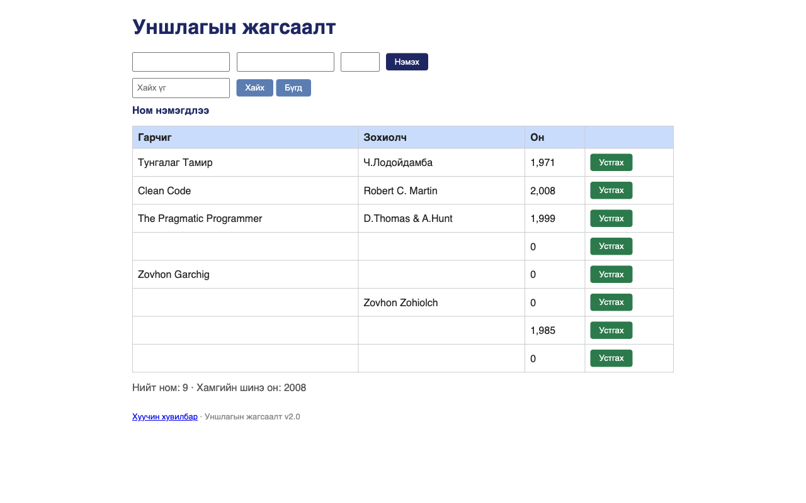
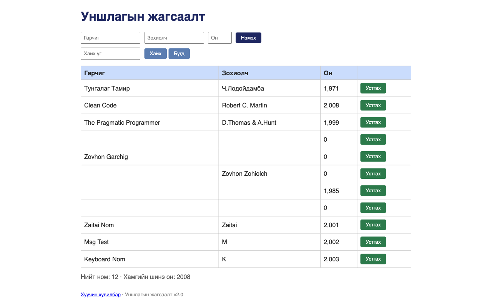

# BUG-01: Дутуу, хоосон эсвэл зөвхөн зайтай талбартай ном алдаагүй нэмэгддэг

Орчин:  Уншлагын жагсаалт v2.0, Google Chrome 157.0.8103.79 ба curl 8.7.1, macOS 26.5.2, 2026-11-23  
Урьдчилсан нөхцөл: node app.js-ийг шинээр асаасан (анхны 3 ном)

## Дахин гаргах алхам
1. Браузераар http://localhost:3000 нээ.
2. Гурван талбарыг хоосон үлдээгээд «Нэмэх» дар.
3. Зөвхөн Гарчиг талбарт `Zovhon Garchig` бичээд (бусад хоосон) «Нэмэх» дар.
4. Гарчиг, Зохиолч, Он гурвуулд зөвхөн 3 зай (`   `) бичээд «Нэмэх» дар.
5. Терминалд: `curl -i -X POST localhost:3000/api/books -H 'Content-Type: application/json' -d '{}'`

Хүлээгдэж байсан: «Ном нэмэхэд Гарчиг, Зохиолч, Он гурван талбар бүгд заавал бөглөгдсөн байх ёстой; дутуу бол ном нэмэгдэхгүй, ойлгомжтой алдааны мессеж харагдана.»  
Бодит үр дүн:     Алхам 2-4 бүгд «Ном нэмэгдлээ» мессежтэй нэмэгдэнэ: гарчиг, зохиолч хоосон, он «0» мөр; зөвхөн гарчигтай мөр; харагдахгүй зайтай мөр. Алдааны мессеж нэг ч удаа гарахгүй. Алхам 5 `HTTP/1.1 201 Created`, `{"title":"","author":""}` он ч үгүй ном үүснэ (`[]` body ч мөн адил).

Ноцтой байдал: Major. Гол үйлдлийн заавал шалгалт UI ба API аль алинд байхгүй, жагсаалтад ялгагдахгүй хоосон мөрүүд хуримтлагдана.  
Хавсралт:          · [evidence/bug-01-curl.txt](../evidence/bug-01-curl.txt)  
Олдсон аялал:  Couch Potato, Saboteur
