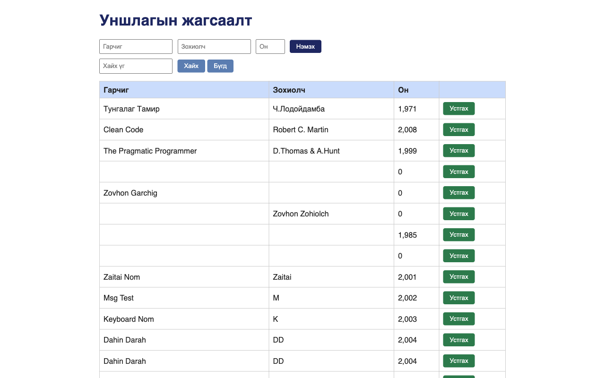
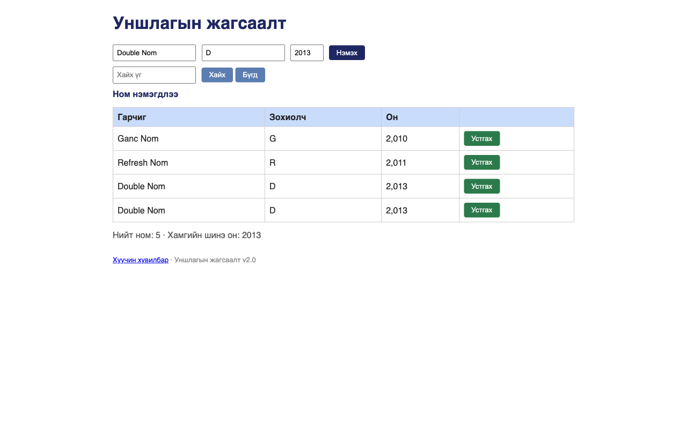

# BUG-02: «Нэмэх»-ийг дахин эсвэл хурдан дарахад нэг ном олон удаа нэмэгдэнэ

Орчин:  Уншлагын жагсаалт v2.0, Google Chrome 157.0.8103.79, macOS 26.5.2, 2026-11-23  
Урьдчилсан нөхцөл: node app.js-ийг шинээр асаасан (анхны 3 ном)

## Дахин гаргах алхам
1. Браузераар http://localhost:3000 нээ.
2. Гарчиг `Dahin Darah`, Зохиолч `D`, Он `2000` бичээд «Нэмэх» дар.
3. Талбарууд цэвэрлэгдээгүй хэвээр тул «Нэмэх»-ийг дахин 2 удаа дар.
4. Гарчигийг `Double Nom` болгоод «Нэмэх» дээр хурдан хоёр товш (double click).

Хүлээгдэж байсан: «Ижил гарчиг, зохиолчтой ном давхардуулж нэмэгдэхгүй.» Нэмсний дараа талбар цэвэрлэгдэж, илгээж байх үед товч түр идэвхгүй болох ёстой.  
Бодит үр дүн:     Алхам 2-3-ын дараа «Dahin Darah» 3 мөр болно. Алхам 4-т «Double Nom» 2 мөр нэмэгдэнэ. Нэмсний дараа талбарууд утгаа хадгалсаар, товч идэвхгүй болдоггүй.

Ноцтой байдал: Major. Санамсаргүй давтан даралт бүр давхардсан өгөгдөл үүсгэнэ.  
Хавсралт:         
Олдсон аялал:  Couch Potato, FedEx
