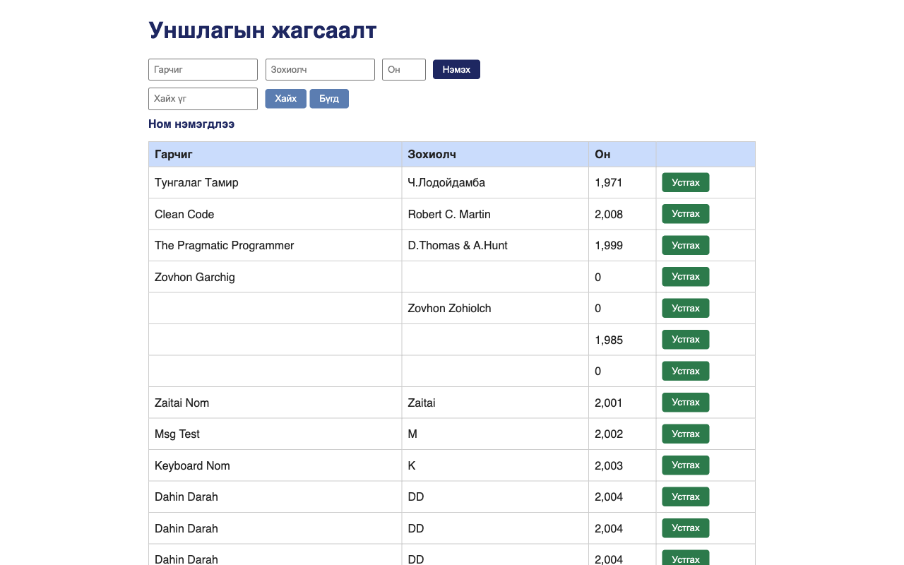
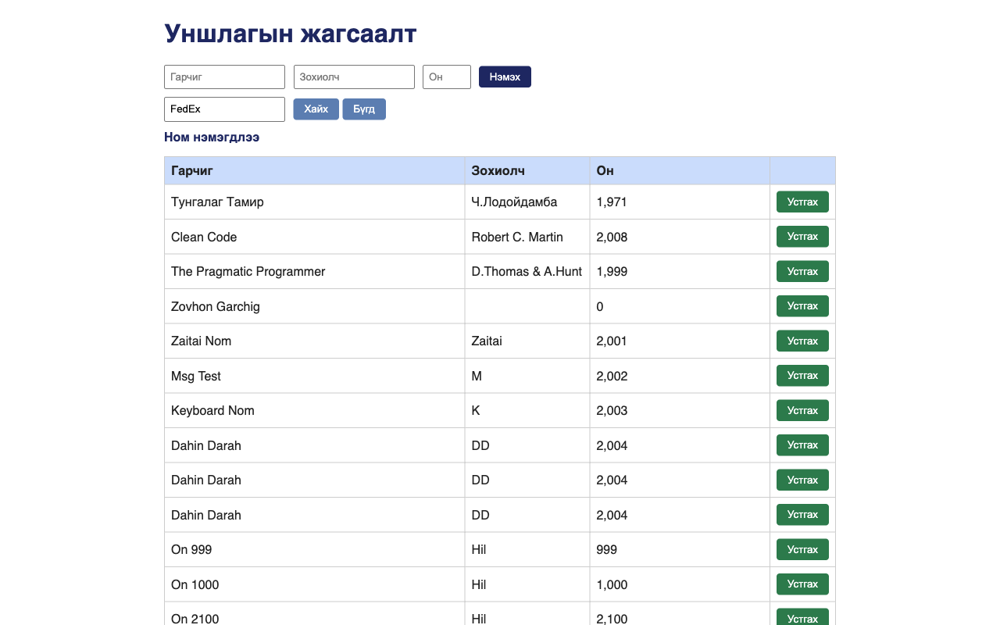

# BUG-03: Ном устгасны дараа «Ном нэмэгдлээ» гэсэн буруу мессеж гарна

Орчин:  Уншлагын жагсаалт v2.0, Google Chrome 157.0.8103.79, macOS 26.5.2, 2026-11-23  
Урьдчилсан нөхцөл: node app.js-ийг шинээр асаасан (анхны 3 ном)

## Дахин гаргах алхам
1. Браузераар http://localhost:3000 нээ.
2. «Clean Code» мөрийн «Устгах» товчийг дар.

Хүлээгдэж байсан: «Үйлдэл бүрийн дараах мессеж тухайн үйлдэлдээ тохирно.» «Ном устгагдлаа» гэх мэт мессеж гарах ёстой.  
Бодит үр дүн:     «Clean Code» арилж, мессеж хэсэгт «Ном нэмэгдлээ» гарна. Устгахаас өмнө баталгаажуулах асуулт ч гарахгүй. Хайлтын үр дүнгээс устгахад хүснэгт бүх жагсаалт руу буцаж, хайлтын талбарт үг үлдэнэ.

Ноцтой байдал: Minor. Үйлдэл зөв ажилласан ч мессеж хэрэглэгчийг төөрөгдүүлнэ.  
Хавсралт:         
Олдсон аялал:  Couch Potato, FedEx
