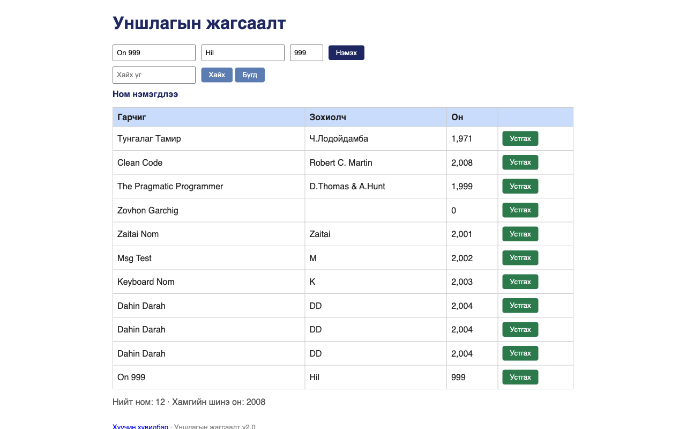
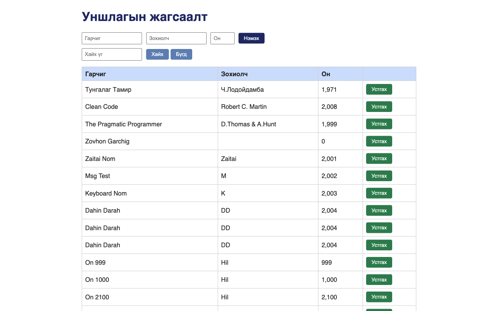
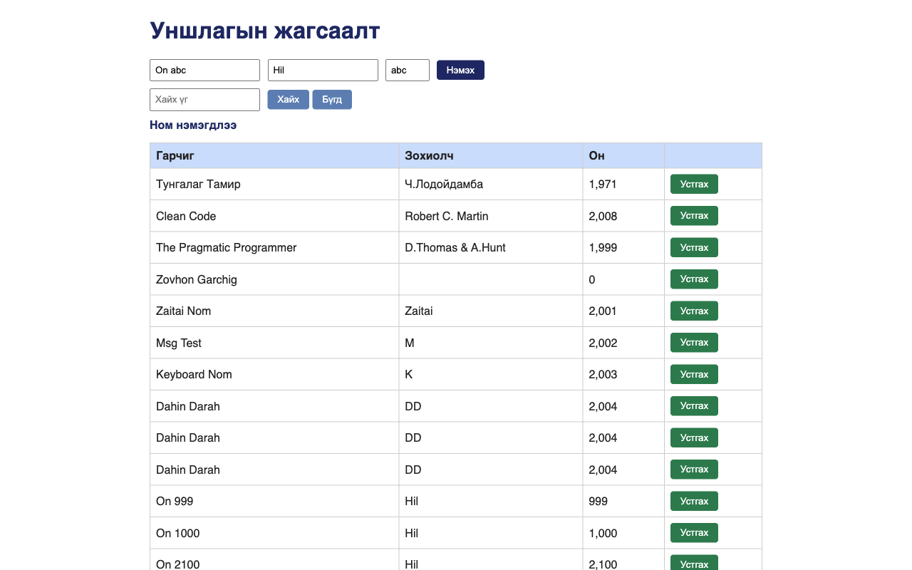
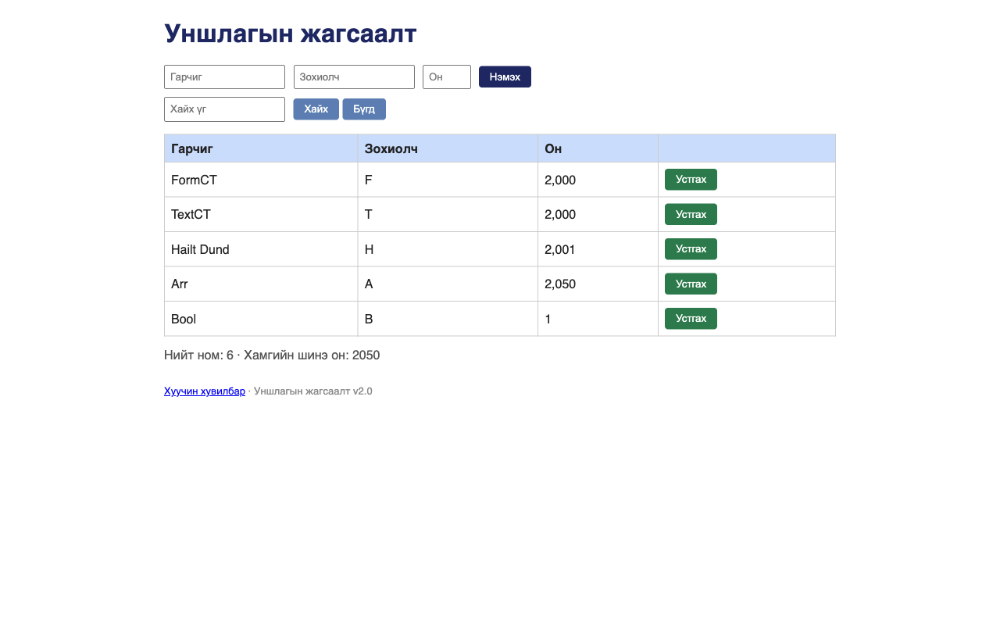

# BUG-04: Он талбар 1000-2100 хязгаараас гадуурх, бутархай, тоон бус утгыг хүлээн авдаг

Орчин:  Уншлагын жагсаалт v2.0, Google Chrome 157.0.8103.79 ба curl 8.7.1, macOS 26.5.2, 2026-11-23  
Урьдчилсан нөхцөл: node app.js-ийг шинээр асаасан (анхны 3 ном)

## Дахин гаргах алхам
1. Браузераар http://localhost:3000 нээ.
2. Гарчиг `On1`, Зохиолч `X`, Он `999` бичээд «Нэмэх» дар.
3. Гарчиг, Онг дараалан `On2` / `2101`, `On3` / `1999.5`, `On4` / `abc`, `On5` / `1e4` болгож тус бүр «Нэмэх» дар.
4. Терминалд `curl -i -X POST localhost:3000/api/books -H 'Content-Type: application/json' -d '{"title":"T3","author":"A","year":[2050]}'` ба `year`-т `true`, `"hello"` өгч дахин илгээ.

Хүлээгдэж байсан: «Он нь 1000-2100 хоорондох бүхэл тоо.» Алхам 2-4 бүгд алдааны мессеж эсвэл 400-аар татгалзагдах ёстой.  
Бодит үр дүн:     Бүгд «Ном нэмэгдлээ» мессежтэй нэмэгдэнэ. Хүснэгтэд «999», «2,101», «1,999.5», «NaN», «10,000» гэж харагдана, «Хамгийн шинэ он» 10000 болно. API `[2050]`, `true`, `"hello"` бүгдэд `201 Created` буцааж, хүснэгтэд «2,050», «1», «NaN» гэж харагдана. `-5`, `0`, `0x7E4` («2,020»), 20 оронтой тоо ч орно.

Ноцтой байдал: Major. Утгагүй он хадгалагдаж, «Хамгийн шинэ он» статистикийг гажуудуулна.  
Хавсралт:            · [evidence/bug-04-curl.txt](../evidence/bug-04-curl.txt)  
Олдсон аялал:  Antisocial, Saboteur
