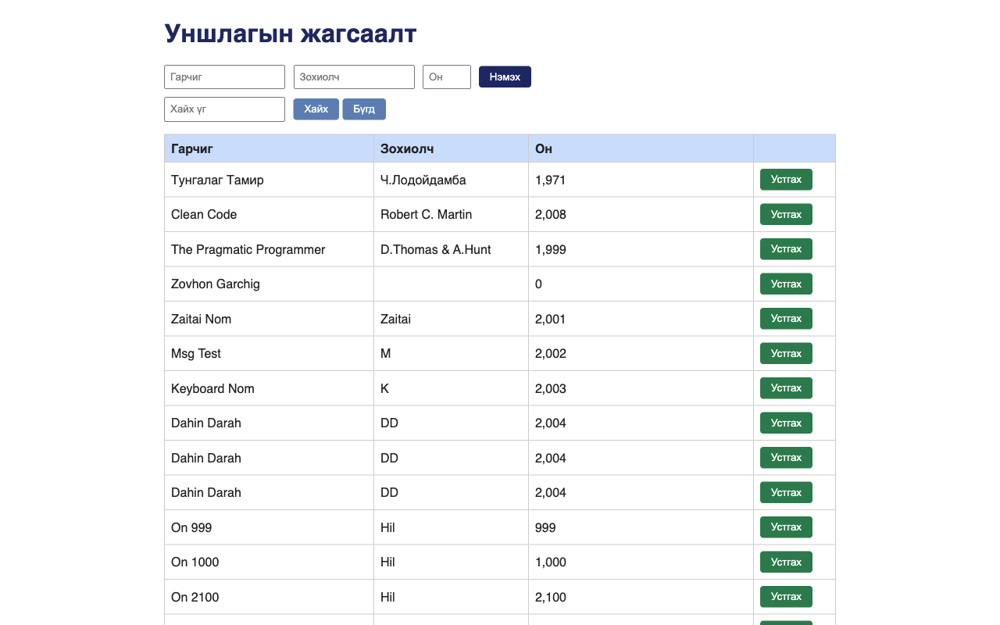

# BUG-05: Он «Infinity» өгөхөд «Хамгийн шинэ он: null» гэж эвдэрнэ

Орчин:  Уншлагын жагсаалт v2.0, Google Chrome 157.0.8103.79 ба curl 8.7.1, macOS 26.5.2, 2026-11-23  
Урьдчилсан нөхцөл: node app.js-ийг шинээр асаасан (анхны 3 ном)

## Дахин гаргах алхам
1. Браузераар http://localhost:3000 нээ.
2. Гарчиг `Inf`, Зохиолч `A`, Он `Infinity` бичээд «Нэмэх» дар.
3. Терминалд: `curl -i localhost:3000/api/stats`

Хүлээгдэж байсан: «Он нь 1000-2100 хоорондох бүхэл тоо.» «Infinity» татгалзагдаж, статистик эвдрэхгүй байх ёстой.  
Бодит үр дүн:     Ном нэмэгдэж хүснэгтэд он «∞» гэж харагдана. Доор «Хамгийн шинэ он: null» болно. `/api/stats` `{"total":5,"newest":null}` буцаана. Тэр мөрийг устгахад статистик сэргэнэ.

Ноцтой байдал: Minor. Хэрэглэгчид «null» гэх техникийн утга харагдана.  
Хавсралт:       · [evidence/bug-05-curl.txt](../evidence/bug-05-curl.txt)  
Олдсон аялал:  Antisocial
