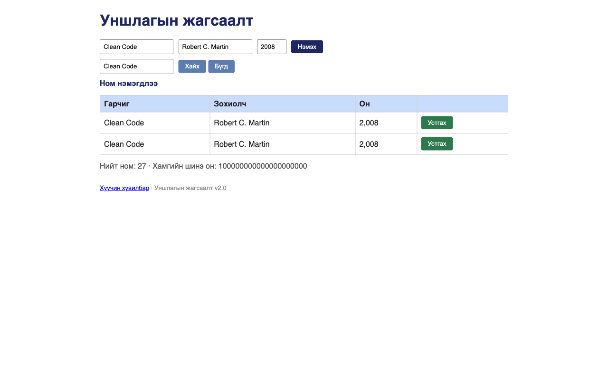

# BUG-06: Ижил гарчиг, зохиолчтой номыг давхардуулж нэмэх боломжтой

Орчин:  Уншлагын жагсаалт v2.0, Google Chrome 157.0.8103.79, macOS 26.5.2, 2026-11-23  
Урьдчилсан нөхцөл: node app.js-ийг шинээр асаасан (анхны 3 ном)

## Дахин гаргах алхам
1. Браузераар http://localhost:3000 нээ.
2. Гарчиг `Clean Code`, Зохиолч `Robert C. Martin`, Он `2008` бичээд «Нэмэх» дар.
3. Гарчигийг `clean code`, Зохиолчийг `ROBERT C. MARTIN` болгоод «Нэмэх» дар.
4. Гарчигийг `Clean Code ` (ард нь зай), Зохиолчийг `Robert C. Martin` болгоод «Нэмэх» дар.

Хүлээгдэж байсан: «Ижил гарчиг, зохиолчтой ном давхардуулж нэмэгдэхгүй.»  
Бодит үр дүн:     Гурван алхам бүгд «Ном нэмэгдлээ» мессежтэй нэмэгдэж, «Clean Code» 4 мөр болно.

Ноцтой байдал: Major. Жагсаалтад давхардсан өгөгдөл хуримтлагдана.  
Хавсралт:         
Олдсон аялал:  Antisocial
