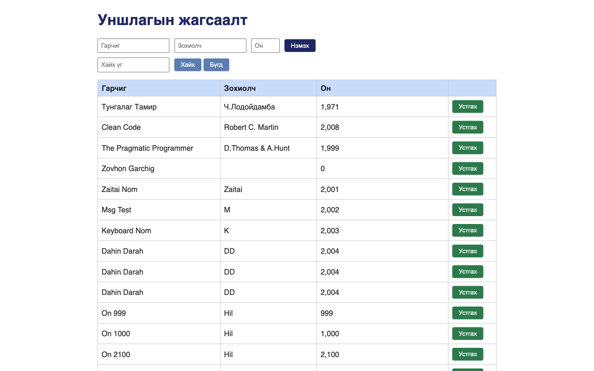
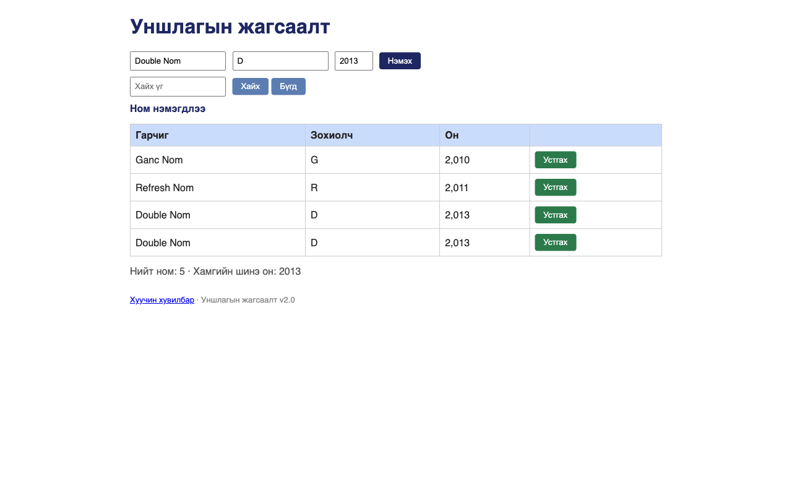

# BUG-06: Ижил ном давхардуулж нэмэгдэнэ, «Нэмэх»-ийг дахин дарахад ч давхардана

Орчин:  Уншлагын жагсаалт v2.0, Google Chrome 157.0.8103.79, macOS 26.5.2, 2026-11-23  
Урьдчилсан нөхцөл: node app.js-ийг шинээр асаасан (анхны 3 ном)

## Дахин гаргах алхам
1. Браузераар http://localhost:3000 нээ.
2. Гарчиг `Clean Code`, Зохиолч `Robert C. Martin`, Он `2008` бичээд «Нэмэх» дар.
3. Гарчигийг `clean code`, Зохиолчийг `ROBERT C. MARTIN` болгоод «Нэмэх» дар.
4. Гарчиг `Double Nom`, Зохиолч `D`, Он `2007` бичээд «Нэмэх» дээр хурдан хоёр товш (double click).

Хүлээгдэж байсан: «Ижил гарчиг, зохиолчтой ном давхардуулж нэмэгдэхгүй.»  
Бодит үр дүн:     Алхам 2, 3 «Ном нэмэгдлээ» мессежтэй нэмэгдэж «Clean Code» 3 мөр болно. Алхам 4-т «Double Nom» 2 мөр нэмэгдэнэ. Нэмсний дараа талбарууд цэвэрлэгдэхгүй, товч идэвхгүй болдоггүй тул «Нэмэх»-ийг дахин дарах бүрд ижил ном дахин нэмэгдэнэ.

Ноцтой байдал: Major. Санамсаргүй давтан даралт бүр давхардсан өгөгдөл үүсгэнэ.  
Хавсралт:           
Олдсон аялал:  Antisocial, Couch Potato, FedEx
