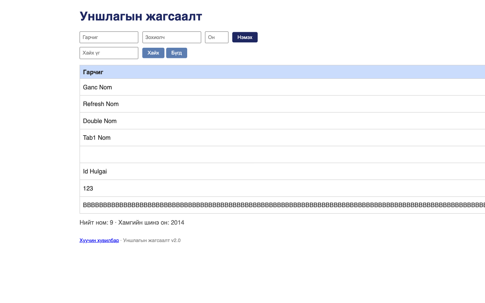

# BUG-07: Текстийн уртад хязгаар байхгүй, зайгүй урт гарчиг хүснэгтийг эвдэж «Устгах»-ыг дэлгэцээс гаргана

Орчин:  Уншлагын жагсаалт v2.0, Google Chrome 157.0.8103.79 ба curl 8.7.1, macOS 26.5.2, 2026-11-23  
Урьдчилсан нөхцөл: node app.js-ийг шинээр асаасан (анхны 3 ном)

## Дахин гаргах алхам
1. Браузераар http://localhost:3000 нээ.
2. DevTools Console-д `copy('A'.repeat(500))` ажиллуулж 500 тэмдэгт хуул.
3. Гарчиг талбарт буулга (Cmd+V), Зохиолч `Urt`, Он `2015` бичээд «Нэмэх» дар.
4. Терминалд 100000 тэмдэгттэй гарчиг илгээ (командыг [evidence/bug-07-curl.txt](../evidence/bug-07-curl.txt)-ээс үз).

Хүлээгдэж байсан: «... хүснэгт ямар ч урттай оролтод эвдрэхгүй.» Урт текст мөр шилжих эсвэл таслагдах, уртын хязгаартай байх ёстой.  
Бодит үр дүн:     Алхам 3-ын дараа хүснэгт хэвтээ чиглэлд сунаж, бүх мөрийн «Зохиолч», «Он», «Устгах» дэлгэцээс гарна. Алхам 4 `201 Created`, ийм мөр байгаа үед UI-аас ямар ч номыг устгах товч харагдахгүй. Зайтай 500 тэмдэгт мөр шилжиж зөв багтдаг тул асуудал зайгүй урт үгэнд байна.

Ноцтой байдал: Major. Нэг урт оролт бүх мөрийн «Устгах» товчийг харагдахгүй болгодог.  
Хавсралт:        · [evidence/bug-07-curl.txt](../evidence/bug-07-curl.txt)  
Олдсон аялал:  Antisocial, Saboteur
