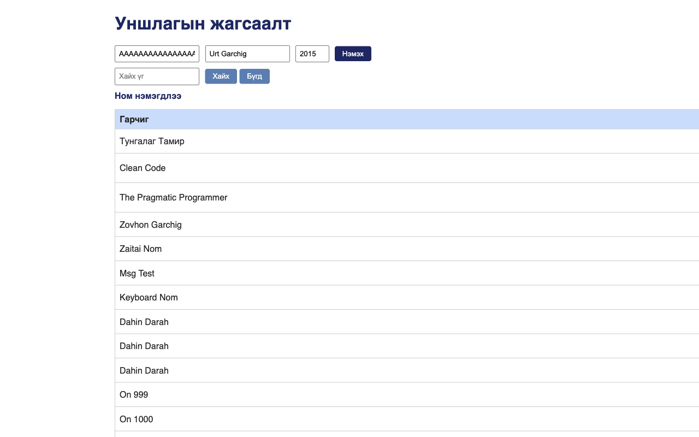
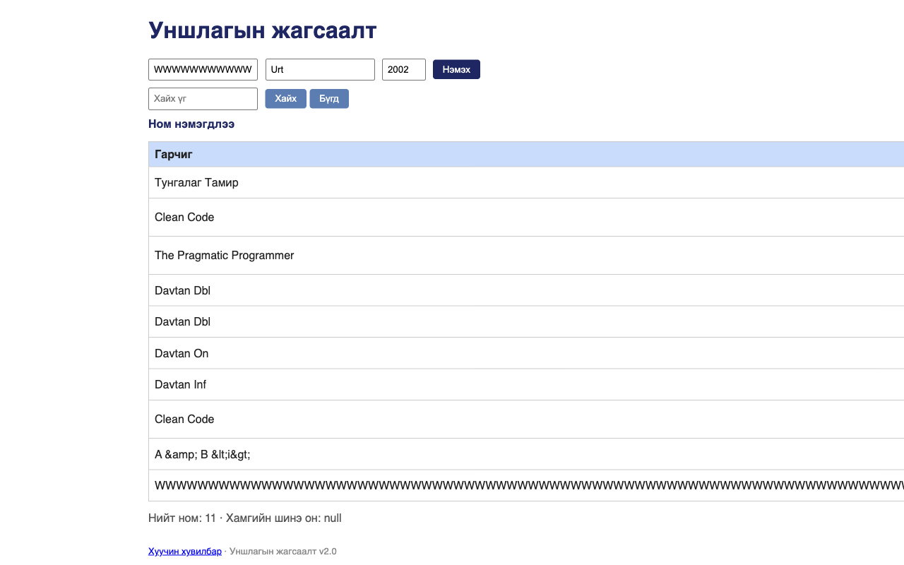

# BUG-07: Зайгүй урт гарчиг хүснэгтийг эвдэж «Устгах»-ыг дэлгэцээс гаргана

Орчин:  Уншлагын жагсаалт v2.0, Google Chrome 157.0.8103.79, macOS 26.5.2, 2026-11-23  
Урьдчилсан нөхцөл: node app.js-ийг шинээр асаасан (анхны 3 ном)

## Дахин гаргах алхам
1. Браузераар http://localhost:3000 нээ.
2. DevTools Console-д `copy('A'.repeat(500))` ажиллуулж 500 тэмдэгт хуул.
3. Гарчиг талбарт буулга (Cmd+V), Зохиолч `Urt`, Он `2015` бичээд «Нэмэх» дар.

Хүлээгдэж байсан: «... хүснэгт ямар ч урттай оролтод эвдрэхгүй.» Урт текст мөр шилжих эсвэл таслагдах ёстой.  
Бодит үр дүн:     Алхам 3-ын дараа хүснэгт хэвтээ чиглэлд сунаж, бүх мөрийн «Зохиолч», «Он», «Устгах» дэлгэцээс гарна. Зохиолч талбарт 300 тэмдэгт өгөхөд ч адил. Зайтай 500 тэмдэгт мөр шилжиж зөв багтдаг тул асуудал зайгүй урт үгэнд байна.

Ноцтой байдал: Major. Нэг урт оролт бүх мөрийн «Устгах» товчийг харагдахгүй болгодог.  
Хавсралт:         
Олдсон аялал:  Antisocial
