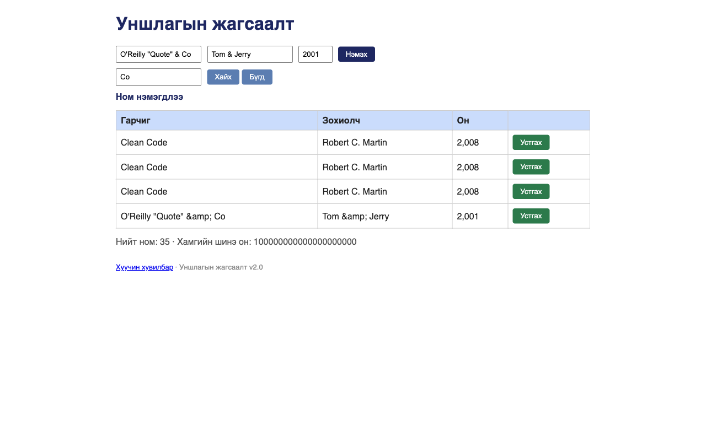
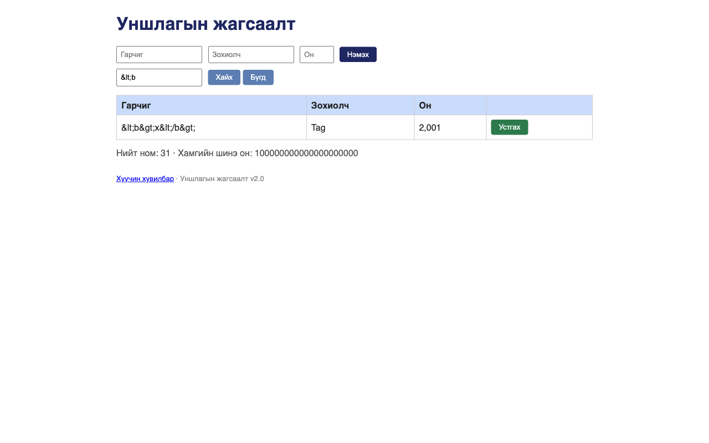
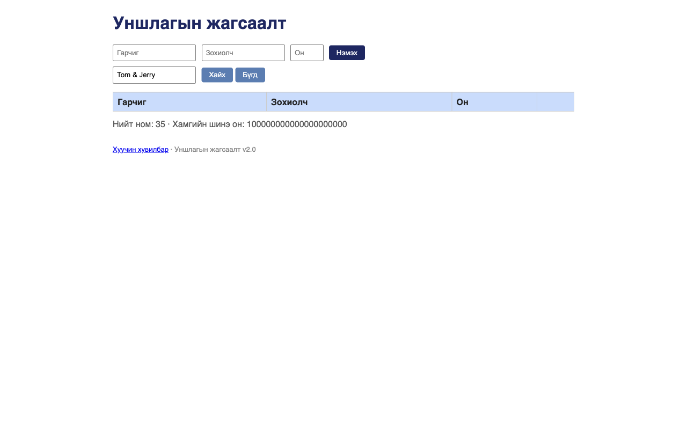

# BUG-08: `&`, `<`, `>` хоёр удаа escape хийгдэж `&amp;` гэж харагдаж, хайлтаар олдохгүй

Орчин:  Уншлагын жагсаалт v2.0, Google Chrome 157.0.8103.79 ба curl 8.7.1, macOS 26.5.2, 2026-11-23  
Урьдчилсан нөхцөл: node app.js-ийг шинээр асаасан (анхны 3 ном)

## Дахин гаргах алхам
1. Браузераар http://localhost:3000 нээ.
2. Гарчиг `Tom & Jerry`, Зохиолч `<b>x</b>`, Он `2000` бичээд «Нэмэх» дар.
3. «Хайх үг» талбарт `Tom & Jerry` бичээд «Хайх» дар.
4. Терминалд: `curl -i localhost:3000/api/books`

Хүлээгдэж байсан: Эрүүл ухаан: хэрэглэгчийн бичсэн текст яг бичсэнээрээ хадгалагдаж, харагдаж, хайлтаар олдоно.  
Бодит үр дүн:     Алхам 2-т хүснэгтэд `Tom &amp; Jerry`, `&lt;b&gt;x&lt;/b&gt;` гэж харагдана. Алхам 3-т 0 мөр. Алхам 4-т сервер `"title":"Tom &amp; Jerry"` гэж escape хийсэн утга хадгалсан, хуудас түүнийг дахин escape хийдэг. XSS (`<script>`, ``) ажиллахгүй.

Ноцтой байдал: Major. Хадгалагдсан өгөгдөл өөрчлөгдөж, `&` агуулсан ном буруу харагдаж, хайлтаар олдохгүй.  
Хавсралт:         · [evidence/bug-08-curl.txt](../evidence/bug-08-curl.txt)  
Олдсон аялал:  Antisocial
