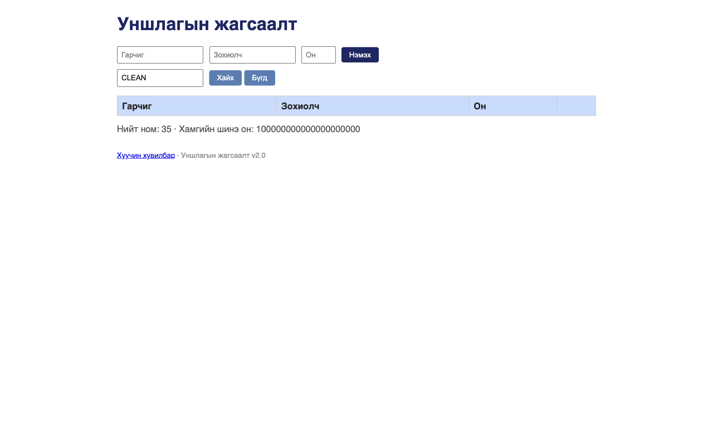

# BUG-09: Хайлт том, жижиг үсгийг ялгадаг (латин ба кирилл)

Орчин:  Уншлагын жагсаалт v2.0, Google Chrome 157.0.8103.79 ба curl 8.7.1, macOS 26.5.2, 2026-11-23  
Урьдчилсан нөхцөл: node app.js-ийг шинээр асаасан (анхны 3 ном)

## Дахин гаргах алхам
1. Браузераар http://localhost:3000 нээ.
2. «Хайх үг» талбарт `clean` бичээд «Хайх» дар.
3. `Clean` гэж хайна.
4. `лодой` ба `Лодой` гэж хайна.

Хүлээгдэж байсан: «Хайлт гарчиг болон зохиолчоос хайх ба том/жижиг үсэг ЯЛГАХГҮЙ.»  
Бодит үр дүн:     Алхам 2 хоосон хүснэгт, алхам 3 «Clean Code» 1 мөр. Алхам 4-т `лодой` 0, `Лодой` «Тунгалаг Тамир» олдоно.

Ноцтой байдал: Major. Жижиг үсгээр хайхад байгаа ном олдохгүй.  
Хавсралт:       · [evidence/bug-09-curl.txt](../evidence/bug-09-curl.txt)  
Олдсон аялал:  Antisocial
