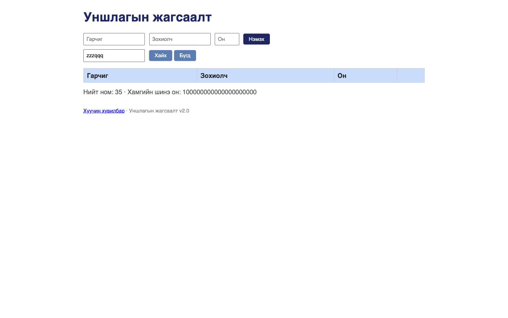

# BUG-10: Хайлтаар юу ч олдохгүй үед мессеж гарахгүй

Орчин:  Уншлагын жагсаалт v2.0, Google Chrome 157.0.8103.79, macOS 26.5.2, 2026-11-23  
Урьдчилсан нөхцөл: node app.js-ийг шинээр асаасан (анхны 3 ном)

## Дахин гаргах алхам
1. Браузераар http://localhost:3000 нээ.
2. «Хайх үг» талбарт `zzzqqq` бичээд «Хайх» дар.

Хүлээгдэж байсан: «Үйлдэл бүрийн дараах мессеж тухайн үйлдэлдээ тохирно.» «Ном олдсонгүй» гэх мессеж гарах ёстой.  
Бодит үр дүн:     Хүснэгтэд толгой мөр л үлдэнэ, мессеж гарахгүй. «Нийт ном: 4» хэвээр тул хэрэглэгч хайлт ажилласан эсэхийг мэдэхгүй.

Ноцтой байдал: Minor. Хоосон үр дүнг алдаанаас ялгах боломжгүй.  
Хавсралт:        
Олдсон аялал:  Antisocial
