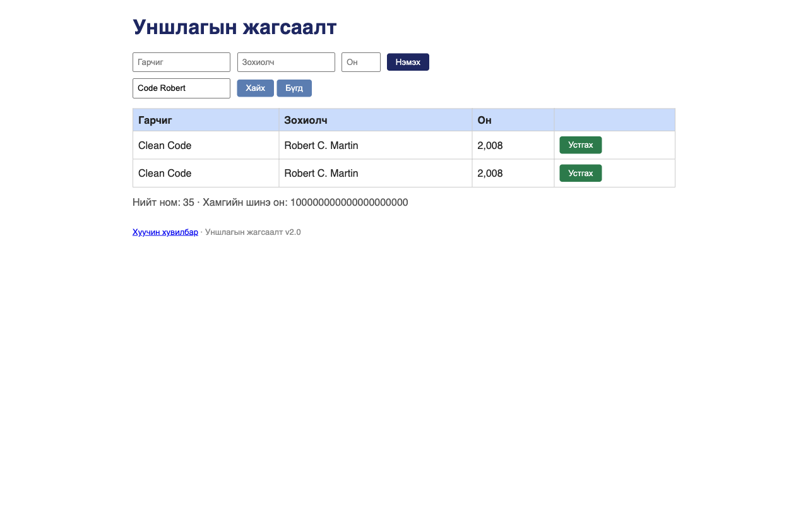

# BUG-11: Хайлт гарчиг ба зохиолчийг залгаж хайдаг тул хоёр талбарын заагаар хуурмаг олдоц гарна

Орчин:  Уншлагын жагсаалт v2.0, Google Chrome 157.0.8103.79 ба curl 8.7.1, macOS 26.5.2, 2026-11-23  
Урьдчилсан нөхцөл: node app.js-ийг шинээр асаасан (анхны 3 ном)

## Дахин гаргах алхам
1. Браузераар http://localhost:3000 нээ.
2. «Хайх үг» талбарт `Code Robert` бичээд «Хайх» дар.

Хүлээгдэж байсан: «Хайлт гарчиг болон зохиолчоос хайх ...» Гарчиг эсвэл зохиолч аль нэгэнд «Code Robert» байхгүй тул 0 мөр.  
Бодит үр дүн:     «Clean Code / Robert C. Martin» олдоно. Гарчиг + зай + зохиолчийг нэг мөр болгож хайдаг бололтой (`Programmer D.Thomas` ч олддог).

Ноцтой байдал: Minor. Хайлтын үр дүн хэрэглэгчийн хүлээлтээс зөрнө.  
Хавсралт:       · [evidence/bug-11-curl.txt](../evidence/bug-11-curl.txt)  
Олдсон аялал:  Antisocial
