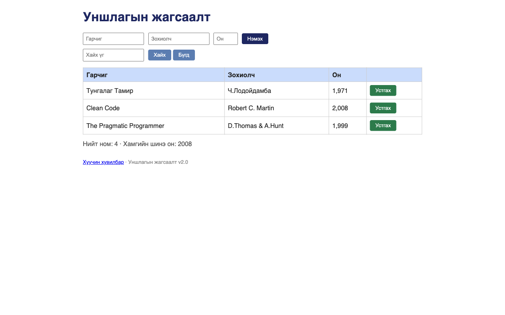
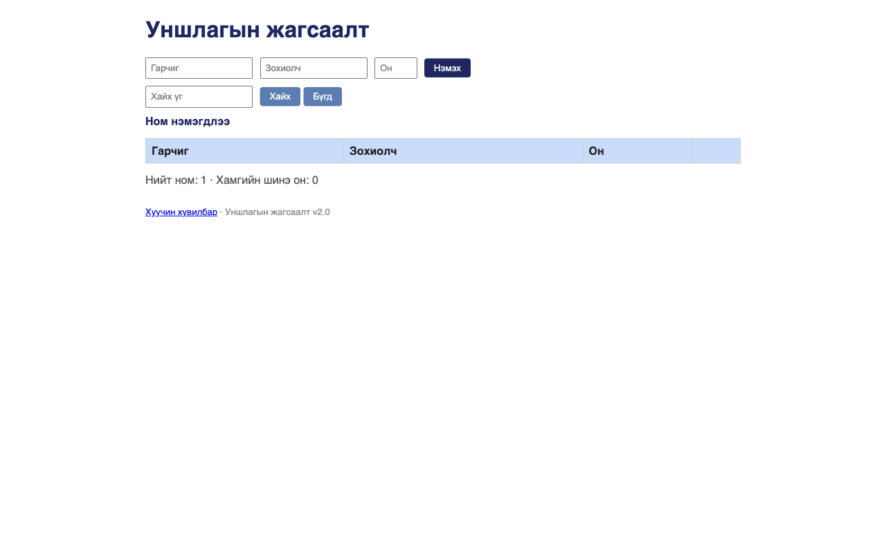

# BUG-12: «Нийт ном» тоолуур хүснэгтийн мөрийн тооноос үргэлж 1-ээр их

Орчин:  Уншлагын жагсаалт v2.0, Google Chrome 157.0.8103.79 ба curl 8.7.1, macOS 26.5.2, 2026-11-23  
Урьдчилсан нөхцөл: node app.js-ийг шинээр асаасан (анхны 3 ном)

## Дахин гаргах алхам
1. Браузераар http://localhost:3000 нээ.
2. Хүснэгтийн 3 мөрийг тоолоод доорх «Нийт ном»-ыг хар.
3. Терминалд `curl -i localhost:3000/api/books` ба `curl -i localhost:3000/api/stats`
4. Браузерт 3 номыг бүгдийг «Устгах»-аар устга.

Хүлээгдэж байсан: «“Нийт ном” тоолуур хүснэгтэд буй номын тоотой тэнцүү.»  
Бодит үр дүн:     Алхам 2-т «Нийт ном: 4». Алхам 3-т 3 ном, `{"total":4,"newest":2008}`. Алхам 4-ийн дараа хүснэгт хоосон ч «Нийт ном: 1 · Хамгийн шинэ он: 0».

Ноцтой байдал: Minor. Үндсэн өгөгдөл зөв ч хураангуй тоо үргэлж буруу.  
Хавсралт:        · [evidence/bug-12-curl.txt](../evidence/bug-12-curl.txt)  
Олдсон аялал:  FedEx
