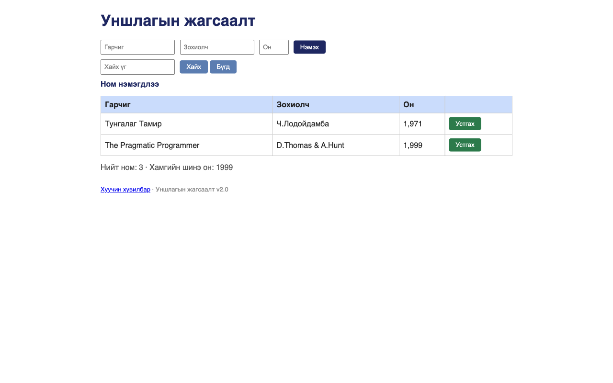

# BUG-14: DELETE /api/books/:id байхгүй id-д 404 биш 200 OK буцаана

Орчин:  Уншлагын жагсаалт v2.0, curl 8.7.1, Node v22.18.0, macOS 26.5.2, 2026-11-23  
Урьдчилсан нөхцөл: node app.js-ийг шинээр асаасан (анхны 3 ном)

## Дахин гаргах алхам
1. `curl -i -X DELETE localhost:3000/api/books/999`
2. `curl -i -X DELETE localhost:3000/api/books/0`
3. `curl -i localhost:3000/api/books`

Хүлээгдэж байсан: Эрүүл ухаан, REST жишиг: байхгүй нөөцийг устгахад `404 Not Found`. Апп өөрөө `GET /api/books/1`-д `404` буцаадаг.  
Бодит үр дүн:     Алхам 1, 2 `HTTP/1.1 200 OK`, `{"result":"OK"}`. Алхам 3-т 3 ном хэвээр, юу ч устгаагүй атлаа амжилттай гэж хариулсан. UI дээр нөгөө tab-д устгагдсан номыг дахин устгахад ч алдаа гарахгүй.

Ноцтой байдал: Minor. Клиент буруу id илгээснээ мэдэхгүй, өгөгдөл гэмтэхгүй.  
Хавсралт:      [evidence/bug-14-curl.txt](../evidence/bug-14-curl.txt) ·   
Олдсон аялал:  Saboteur, FedEx
