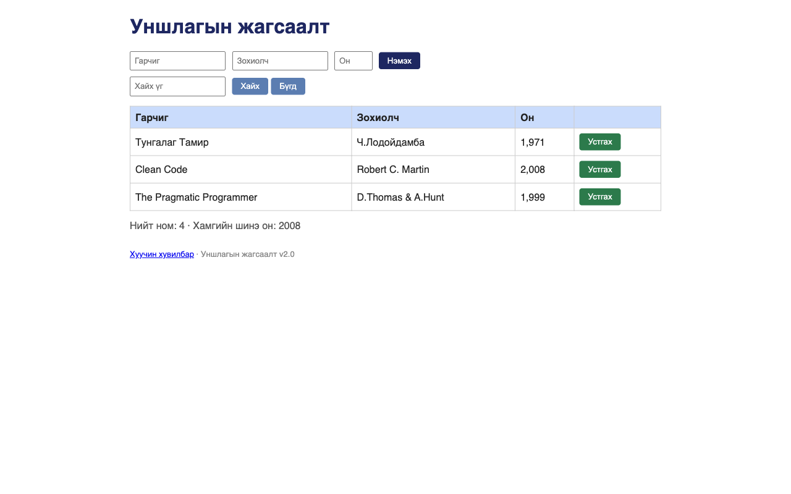

# BUG-17: «Нэмэх» товчны сүүлийн үсэг кирилл «х» биш латин «x»

Орчин:  Уншлагын жагсаалт v2.0, Google Chrome 157.0.8103.79, macOS 26.5.2, 2026-11-23  
Урьдчилсан нөхцөл: node app.js-ийг шинээр асаасан (анхны 3 ном)

## Дахин гаргах алхам
1. Браузераар http://localhost:3000 нээ.
2. Cmd+F (Ctrl+F) дарж кирилл үсгээр `Нэмэх` гэж хайна.
3. «View Page Source» нээгээд `<button class="add"` мөрийг хар.

Хүлээгдэж байсан: «... текстүүд үсгийн алдаагүй.»  
Бодит үр дүн:     Алхам 2-т 0 олдоц. Эх кодод `Нэмэx`, сүүлийн тэмдэгт U+0078 LATIN SMALL LETTER X. Нүдэнд ижил ч хайлт, screen reader, автомат тестийн `getByText('Нэмэх')` олохгүй.

Ноцтой байдал: Cosmetic. Ажиллагаанд нөлөөгүй, текстийн алдаа.  
Хавсралт:       · [evidence/32-nemeh-latin-x.txt](../evidence/32-nemeh-latin-x.txt)  
Олдсон аялал:  Supermodel
