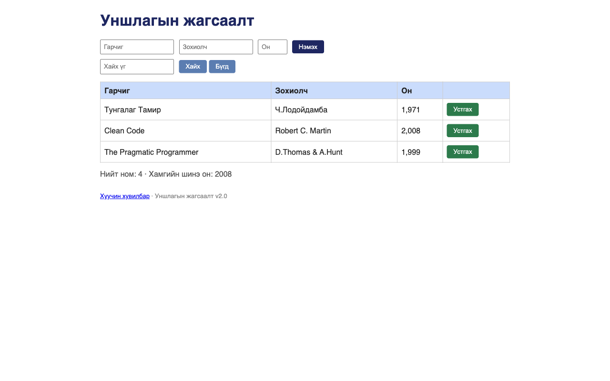

# BUG-18: Аюултай «Устгах» товч улаан биш ногоон өнгөтэй

Орчин:  Уншлагын жагсаалт v2.0, Google Chrome 157.0.8103.79, macOS 26.5.2, 2026-11-23  
Урьдчилсан нөхцөл: node app.js-ийг шинээр асаасан (анхны 3 ном)

## Дахин гаргах алхам
1. Браузераар http://localhost:3000 нээ.
2. Мөр бүрийн «Устгах» товчны өнгийг хар.

Хүлээгдэж байсан: «Аюултай үйлдлийн товч (Устгах) улаан өнгөтэй.»  
Бодит үр дүн:     «Устгах» ногоон (rgb(44,122,75)), «зөвшөөрөх» утгатай өнгө. Баталгаажуулах асуултгүй шууд устгана.

Ноцтой байдал: Minor. Устгах үйлдлийг аюулгүй гэж андуурч дарах эрсдэлтэй.  
Хавсралт:       · [evidence/33-ongo-kontrast.txt](../evidence/33-ongo-kontrast.txt)  
Олдсон аялал:  Supermodel
