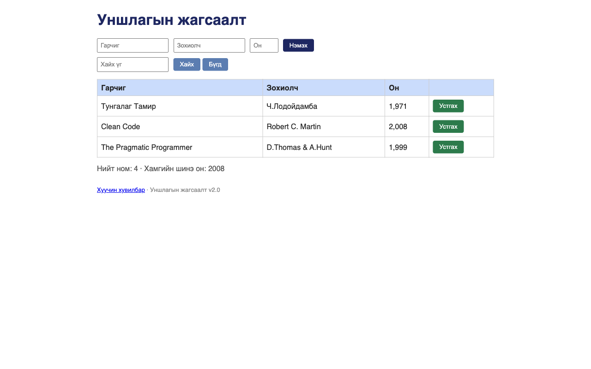
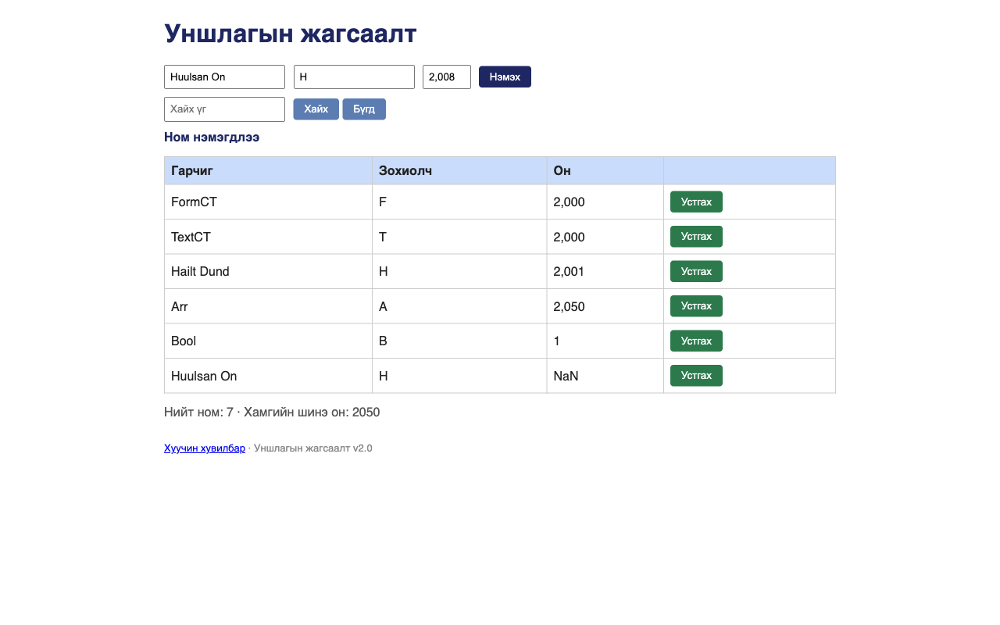

# BUG-19: Он «1,971» гэж мянгатын таслалтай харагдах ба тэр хэлбэрээр оруулахад «NaN» болно

Орчин:  Уншлагын жагсаалт v2.0, Google Chrome 157.0.8103.79, macOS 26.5.2, 2026-11-23  
Урьдчилсан нөхцөл: node app.js-ийг шинээр асаасан (анхны 3 ном)

## Дахин гаргах алхам
1. Браузераар http://localhost:3000 нээ.
2. Хүснэгтийн «Он» баганыг хар.
3. Гарчиг `Taslal`, Зохиолч `T`, Он `2,008` бичээд «Нэмэх» дар.

Хүлээгдэж байсан: «Он ... хүснэгтэд энгийн тоогоор (жишээ нь 1999) харагдана.»  
Бодит үр дүн:     Алхам 2-т «1,971», «2,008», «1,999». Алхам 3-т апп өөрөө харуулдаг хэлбэрээр оруулсан он «NaN» болж нэмэгдэнэ.

Ноцтой байдал: Minor. Өгөгдөл зөв ч харагдах хэлбэр спецификациас зөрнө.  
Хавсралт:         
Олдсон аялал:  Supermodel, Antisocial
