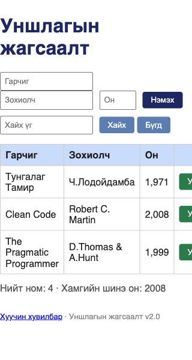

# BUG-20: Утасны дэлгэцэнд хүснэгт багтахгүй, viewport meta байхгүй

Орчин:  Уншлагын жагсаалт v2.0, Google Chrome 157.0.8103.79, macOS 26.5.2, 2026-11-23  
Урьдчилсан нөхцөл: node app.js-ийг шинээр асаасан (анхны 3 ном)

## Дахин гаргах алхам
1. Браузераар http://localhost:3000 нээ.
2. DevTools → Toggle device toolbar, өргөнийг 320px болго.
3. DevTools-ийн төхөөрөмжөөс «iPhone 13» сонго.
4. «View Page Source»-ээс `<meta name="viewport"` хайна.

Хүлээгдэж байсан: «... хүснэгт ямар ч урттай оролтод эвдрэхгүй», эрүүл ухаан: хуудас гар утсанд уншигдахуйц.  
Бодит үр дүн:     Алхам 2-т «Устгах» товчнууд баруун талаар таслагдана. Алхам 3-т хуудас 980px desktop өргөнөөр зурагдаж ~2.5 дахин жижгэрнэ. Алхам 4-т viewport meta байхгүй.

Ноцтой байдал: Minor. Гар утаснаас ашиглахад товч, текст хэт жижиг эсвэл таслагдана.  
Хавсралт:         
Олдсон аялал:  Supermodel
