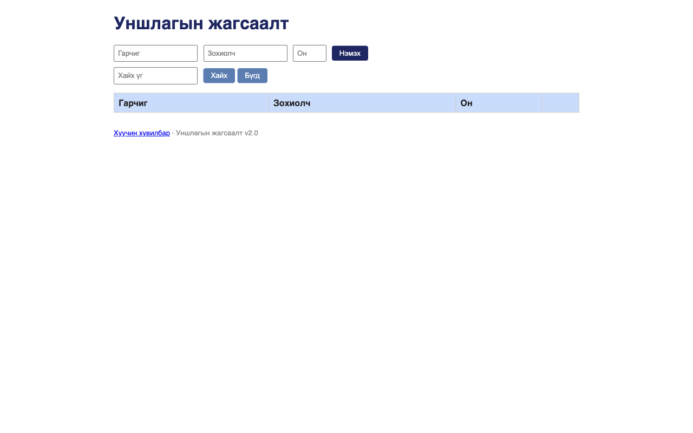

# BUG-21: Он нь объект номыг API хүлээн авч, дараа нь хүснэгт бүхэлдээ алга болж /api/stats серверийг унагана

Орчин:  Уншлагын жагсаалт v2.0, Google Chrome 157.0.8103.79 ба curl 8.7.1, macOS 26.5.2, 2026-11-23  
Урьдчилсан нөхцөл: node app.js-ийг шинээр асаасан (анхны 3 ном)

## Дахин гаргах алхам
1. `curl -i -X POST localhost:3000/api/books -H 'Content-Type: application/json' -d '{"title":"Y","author":"Y","year":{"toString":1,"valueOf":1}}'`
2. Браузераар http://localhost:3000 нээ, дараа нь хуудсыг refresh хий.
3. `curl -i localhost:3000/api/stats`

Хүлээгдэж байсан: «Он нь 1000-2100 хоорондох бүхэл тоо» тул алхам 1 400-аар татгалзагдах ёстой. Нэг буруу бичлэг бусад өгөгдлийг харуулахад саад болохгүй, серверийг унагахгүй.  
Бодит үр дүн:     Алхам 1 `201 Created`. Алхам 2-т хүснэгт хоосон, «Нийт ном» мөр алга, алдааны мессеж байхгүй, refresh хийсэн ч хэвээр. Хөтчийн Console-д `Cannot convert object to primitive value`. Алхам 3-т `Empty reply from server`, терминалд мөн тэр TypeError гарч сервер унана.

Ноцтой байдал: Critical. Нэг муу бичлэг бүх хэрэглэгчид жагсаалтыг харуулахгүй болгож, статистик дуудахад бүх өгөгдлийг устгана.  
Хавсралт:        · [evidence/bug-21-curl.txt](../evidence/bug-21-curl.txt)  
Олдсон аялал:  Saboteur
