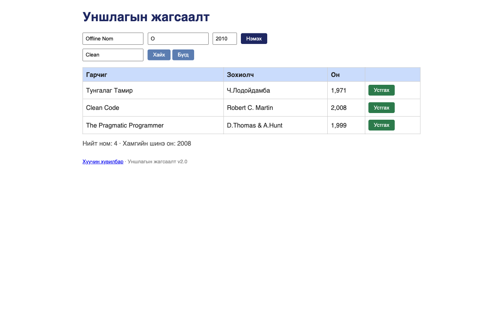
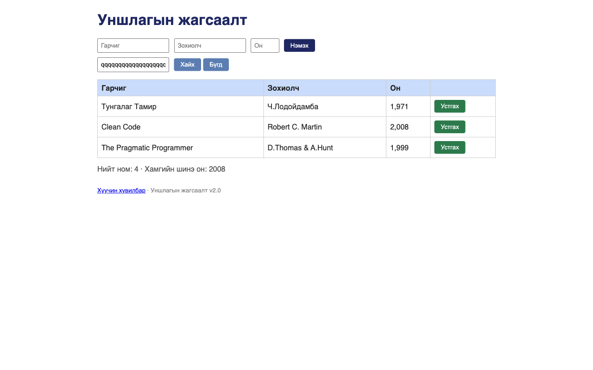

# BUG-22: Сервер хариу өгөхгүй эсвэл алдаа буцаахад UI ямар ч мессеж харуулахгүй

Орчин:  Уншлагын жагсаалт v2.0, Google Chrome 157.0.8103.79, macOS 26.5.2, 2026-11-23  
Урьдчилсан нөхцөл: node app.js-ийг шинээр асаасан (анхны 3 ном)

## Дахин гаргах алхам
1. Браузераар http://localhost:3000 нээ.
2. `node app.js` ажиллаж буй терминалд Ctrl+C дарж серверийг зогсоо (хуудсыг refresh хийлгүй).
3. Гарчиг `Offline Nom`, Зохиолч `O`, Он `2010` бичээд «Нэмэх» дар.
4. «Хайх үг» талбарт `Clean` бичээд «Хайх» дар.

Хүлээгдэж байсан: «Үйлдэл бүрийн дараах мессеж тухайн үйлдэлдээ тохирно.» Сервертэй холбогдож чадаагүй гэсэн алдааны мессеж гарах ёстой.  
Бодит үр дүн:     Алхам 3, 4-т мессеж гарахгүй, хүснэгт хуучнаараа 3 номтой үлдэнэ. Хайлт хийгдсэн мэт харагдах ч үр дүн өөрчлөгдөөгүй. Console-д `Failed to fetch`. 20000 тэмдэгттэй хайлтад сервер `431` буцаахад ч мөн адил чимээгүй.

Ноцтой байдал: Major. Хэрэглэгч үйлдэл амжилтгүй болсныг мэдэхгүй, нэмсэн ном алга болно.  
Хавсралт:         · [evidence/26-urt-hailt.txt](../evidence/26-urt-hailt.txt)  
Олдсон аялал:  Saboteur (BUG-16-аас үүдсэн санаа)
