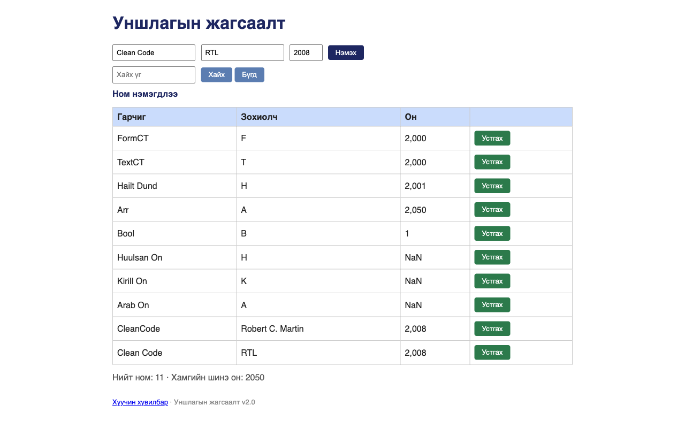
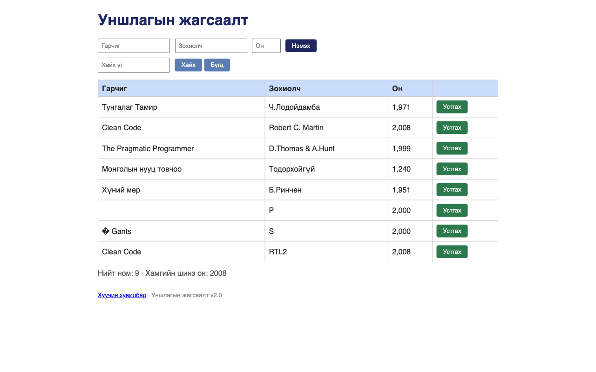
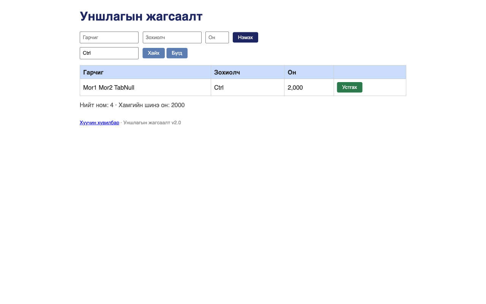

# BUG-24: Үл харагдах ба удирдах тэмдэгт шүүгдэхгүй тул хуурмаг нэр үүсч, харагдсанаар нь хайхад олдохгүй

Орчин:  Уншлагын жагсаалт v2.0, Google Chrome 157.0.8103.79 ба curl 8.7.1, macOS 26.5.2, 2026-11-23  
Урьдчилсан нөхцөл: node app.js-ийг шинээр асаасан (анхны 3 ном)

## Дахин гаргах алхам
1. Терминалд RTL override (U+202E) тэмдэгттэй гарчиг илгээ: `curl -i -X POST localhost:3000/api/books -H 'Content-Type: application/json' -d '{"title":"\u202eedoC naelC","author":"Fake","year":2000}'`
2. `curl -i -X POST localhost:3000/api/books -H 'Content-Type: application/json' -d '{"title":"Mor1\nMor2","author":"A","year":2000}'`
3. Браузераар http://localhost:3000 нээ.
4. `Clean Code` ба `Mor1 Mor2` гэж хайна.

Хүлээгдэж байсан: Эрүүл ухаан: үл харагдах, удирдах тэмдэгт шүүгдэж (эсвэл татгалзагдаж), дэлгэцэнд харагдсан нэрээр ном олддог байх.  
Бодит үр дүн:     Алхам 3-т шинэ мөр яг «Clean Code» мэт, нөгөө нь «Mor1 Mor2» гэж харагдана. Алхам 4-т `Clean Code` зөвхөн жинхэнэ номыг, `Mor1 Mor2` 0 мөр олно. Zero-width space-тэй «CleanCode» ч мөн адил.

Ноцтой байдал: Minor. Жинхэнэ ном мэт хуурмаг бичлэг үүсгэх боломжтой, хайлтаар олдохгүй.  
Хавсралт:         · [evidence/bug-24-curl.txt](../evidence/bug-24-curl.txt)  
Олдсон аялал:  Antisocial, Saboteur
