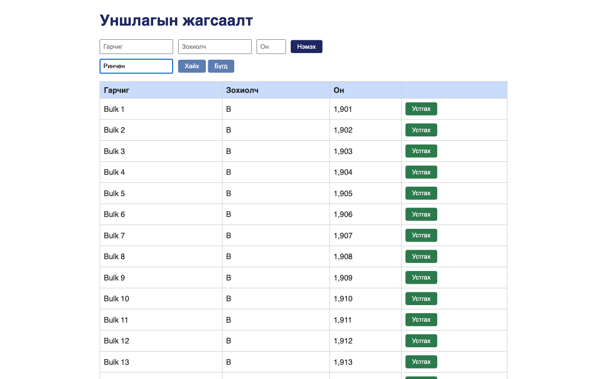

# BUG-25: Хоёр хайлтыг хурдан дараалан хийхэд удаан хайлтын үр дүн сүүлд зурагдаж, талбар ба хүснэгт зөрнө

Орчин:  Уншлагын жагсаалт v2.0, Google Chrome 157.0.8103.79, macOS 26.5.2, 2026-11-23  
Урьдчилсан нөхцөл: node app.js-ийг шинээр асаасан (анхны 3 ном)

## Дахин гаргах алхам
1. Терминалд `node evidence/bulk-nemeh.js 50000`
2. Браузераар http://localhost:3000 нээ (хуудас ачаалахад хэдэн секунд).
3. «Хайх үг» талбарт `B` бичээд «Хайх» дар, 0.3 секунд хүрэхгүй хугацаанд талбарыг `Clean` болгож «Хайх»-ийг дахин дар.

Хүлээгдэж байсан: Эрүүл ухаан: хүснэгт талбарт байгаа сүүлийн хайлтын («Clean») үр дүнг харуулна.  
Бодит үр дүн:     Талбарт `Clean` байхад хүснэгт `B`-ийн 50000 мөрийг харуулна. 2 удаа давтагдсан. 0.3 секундээс удаан завсартай бол зөв.

Ноцтой байдал: Minor. Зөвхөн маш олон номтой үед, хэт хурдан хоёр хайлт хийхэд л гарна.  
Хавсралт:         
Олдсон аялал:  Antisocial (OCD)
